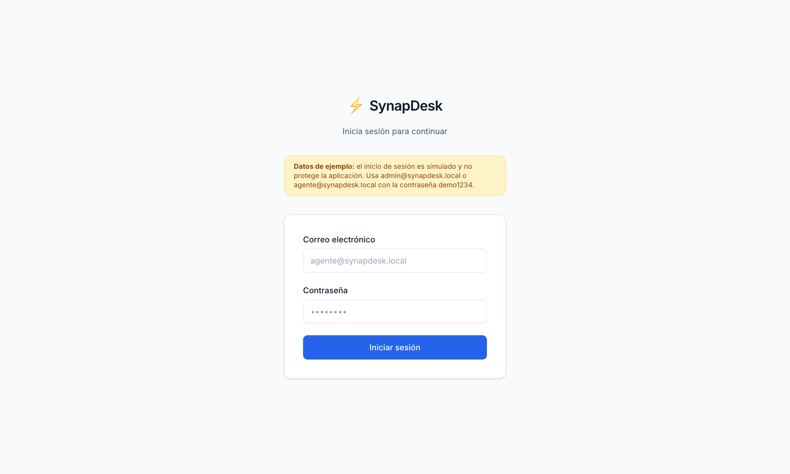
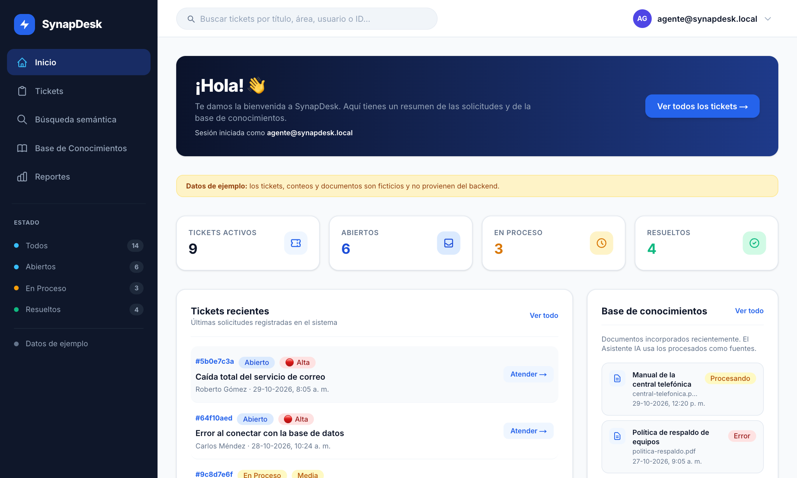
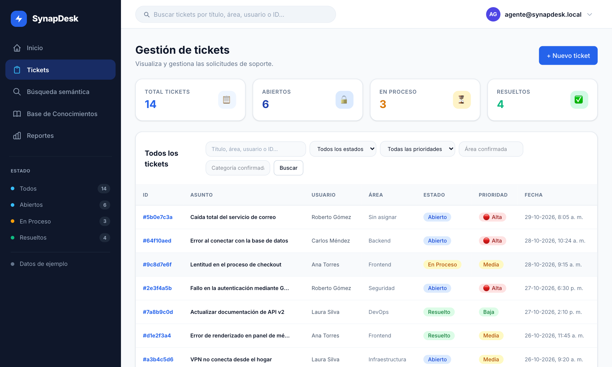
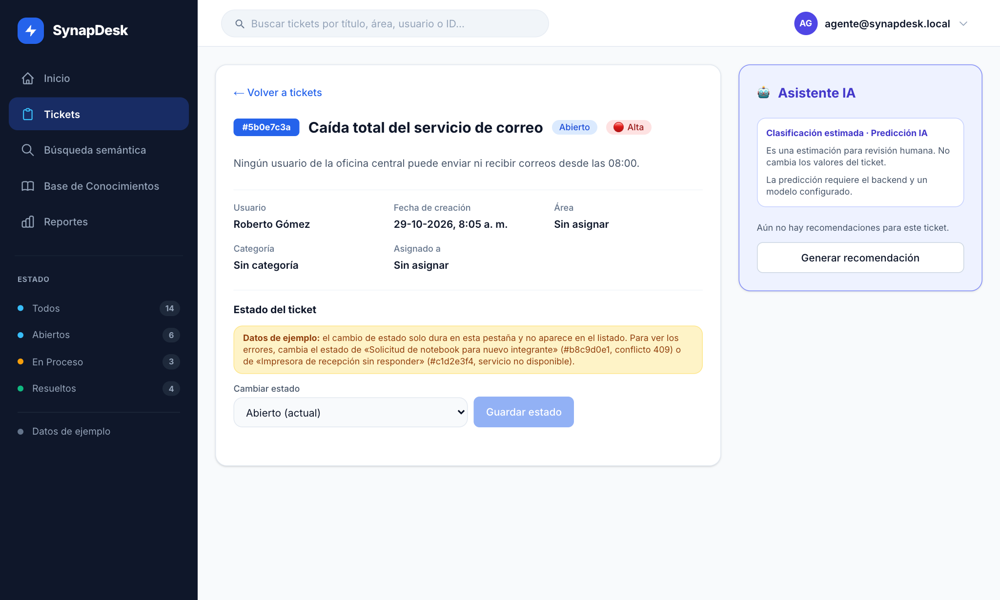
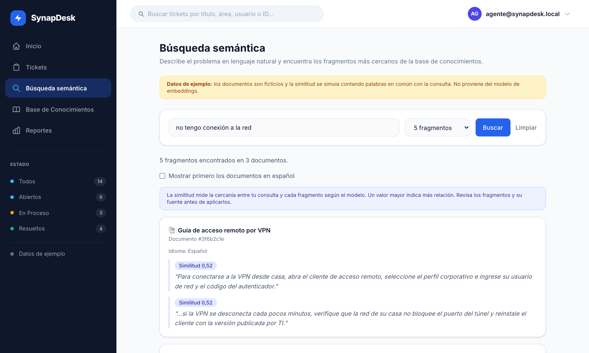
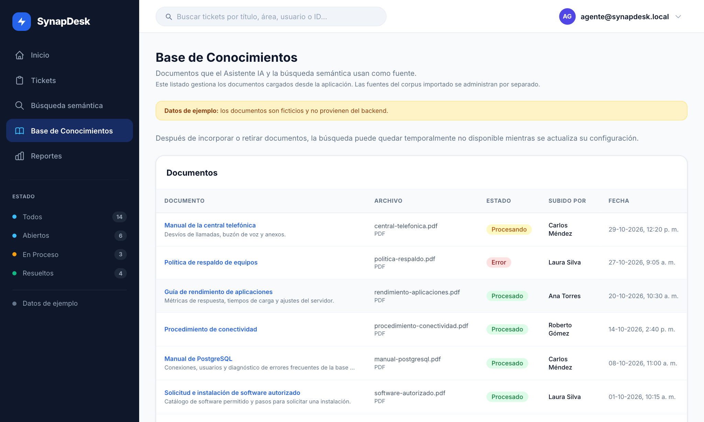
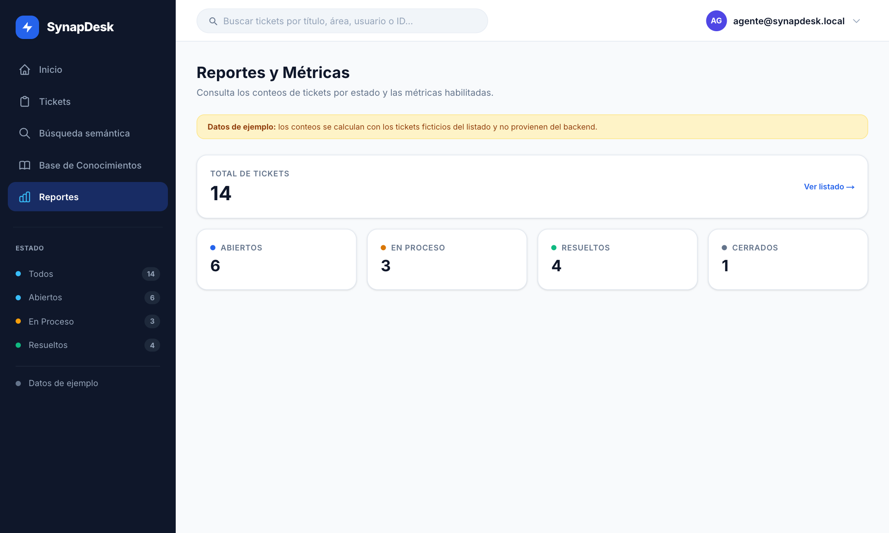
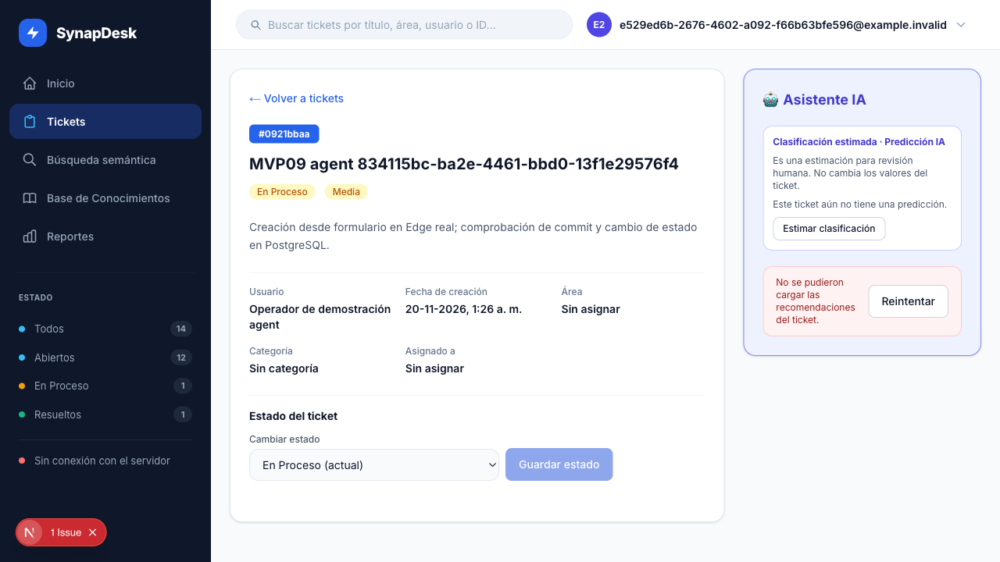
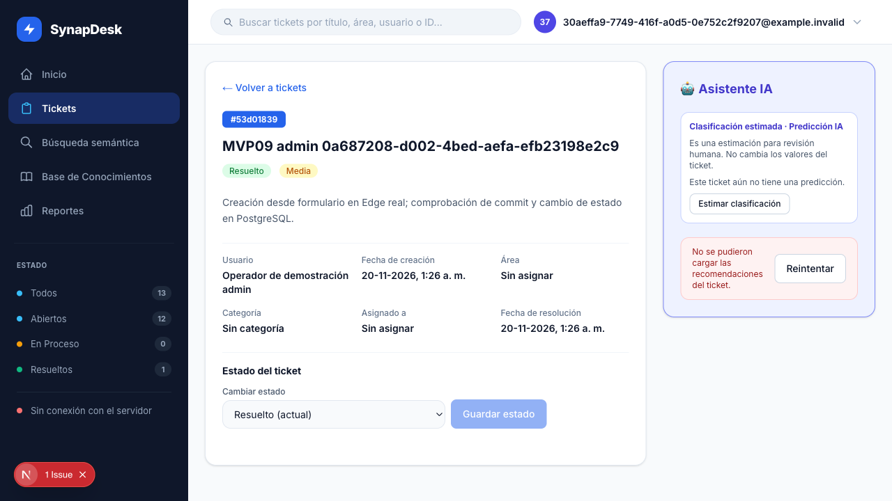

# Evidencias de sistema: Aplicación

Evidencias del frontend de SynapDesk al **20-11-2026**, obtenidas sobre el commit
[`49e88f1`](https://github.com/Krotzup/SynapDesk/commit/49e88f1), que corresponde a `main` con el PR
[#60](https://github.com/Krotzup/SynapDesk/pull/60).

Hay dos tipos de evidencia:

- **Capturas 1 a 7:** el build de producción de Next.js con datos de ejemplo (`NEXT_PUBLIC_USE_MOCKS=true`).
  Los tickets, usuarios y documentos son ficticios y sirven para mostrar todas las pantallas.
- **Capturas 8 y 9 y prueba PT08:** el ensayo local de testing (`APP_ENV=testing`), donde el navegador usa el
  backend real: Chromium ➔ Next.js ➔ FastAPI ➔ PostgreSQL, con una base temporal que se elimina al terminar.
  El ensayo local no es un despliegue: el sistema no está desplegado y el inicio de sesión productivo sigue
  deshabilitado.

## Qué funciona

| Pantalla o flujo | Estado al 20-11-2026 |
|---|---|
| Inicio de sesión, creación, listado, detalle y cambio de estado de tickets | Funcionan de punta a punta en el ensayo local (PT08: 94 de 94 comprobaciones) |
| Filtros del listado, métricas por estado, página de error y página «no encontrado» | Integrados |
| Búsqueda semántica, Asistente IA con revisión humana, predicción de clasificación, base de conocimientos y métricas de IA | Integrados y desactivados por defecto; se habilitan por configuración |
| Administración de usuarios | Fuera del MVP: la pantalla muestra un aviso |

## Cómo ejecutarla con datos de ejemplo

Requisitos: Node.js 20.9 o superior.

```bash
cd frontend
npm ci
echo "NEXT_PUBLIC_USE_MOCKS=true" > .env.local
npm run build
npx next start -p 3000
```

Abrir <http://localhost:3000/login> e ingresar con un usuario de ejemplo: `agente@synapdesk.local` o
`admin@synapdesk.local`, contraseña `demo1234`. Estos usuarios existen solo en los datos de ejemplo del
navegador; no son cuentas reales.

El ensayo local con el backend real se ejecuta con
[`backend/herramientas/ingreso_local`](https://github.com/Krotzup/SynapDesk/tree/main/backend/herramientas/ingreso_local)
(`python -m herramientas.ingreso_local.verificar --modo todo`).

## Capturas

### 1. Inicio de sesión



*Datos de ejemplo.*

### 2. Inicio con resumen de tickets y documentos



*Datos de ejemplo.*

### 3. Listado de tickets con filtros y conteos por estado



*Datos de ejemplo.*

### 4. Detalle del ticket con cambio de estado, clasificación estimada y Asistente IA



*Datos de ejemplo.*

### 5. Búsqueda semántica con fragmentos agrupados por documento



*Datos de ejemplo.*

### 6. Base de conocimientos



*Datos de ejemplo.*

### 7. Métricas de tickets por estado



*Datos de ejemplo.*

### 8. Ticket creado desde el navegador por una cuenta agent (PT08)



*Ensayo local con backend real. Las recomendaciones muestran un error controlado porque el RAG está desactivado
en el ensayo; la prueba confirma que ese fallo no bloquea el ticket. El indicador del menú lateral muestra «Sin
conexión con el servidor» porque el ensayo no expone `/api/v1/ready` al navegador.*

### 9. Ticket creado desde el navegador por una cuenta admin (PT08)



*Ensayo local con backend real.*

## Salidas de pruebas

Carpeta [`Pruebas/`](Pruebas/), del 20-11-2026 sobre el commit `49e88f1`:

| Archivo | Contenido |
|---|---|
| [`pt06.txt`](Pruebas/pt06.txt) | PT06: recorrido de la interfaz con datos de ejemplo en Chromium (20 de 20 comprobaciones) |
| [`pt08-verificador.txt`](Pruebas/pt08-verificador.txt) | PT08: resumen del verificador del ensayo local (118 pruebas HTTP con PostgreSQL y 94 comprobaciones en navegador) |
| [`pt08-recorrido-navegador.txt`](Pruebas/pt08-recorrido-navegador.txt) | PT08: lista de las 94 comprobaciones con las cuentas agent y admin |
| [`frontend.txt`](Pruebas/frontend.txt) | Pruebas del frontend: componentes 59, unitarias 78, búsqueda 15 y proxy 87; TypeScript, ESLint, Prettier y build |
| [`protocolo-ensayo.txt`](Pruebas/protocolo-ensayo.txt) | 49 pruebas del protocolo del ensayo local |
| [`ml.txt`](Pruebas/ml.txt) | Pruebas de Machine Learning: 115 pruebas, 112 aprobadas y 3 omitidas que requieren el modelo real; esas 3 se aprobaron con el modelo real en PT09 ([`ml-completo.txt`](../Base%20de%20datos/Pruebas/ml-completo.txt)) |
| [`pt07.txt`](Pruebas/pt07.txt) | PT07: entrenamiento con la muestra sintética y predicción de tipo, prioridad y área |
| [`fecha.txt`](Pruebas/fecha.txt) | Fecha, hora y commit de la ejecución |
