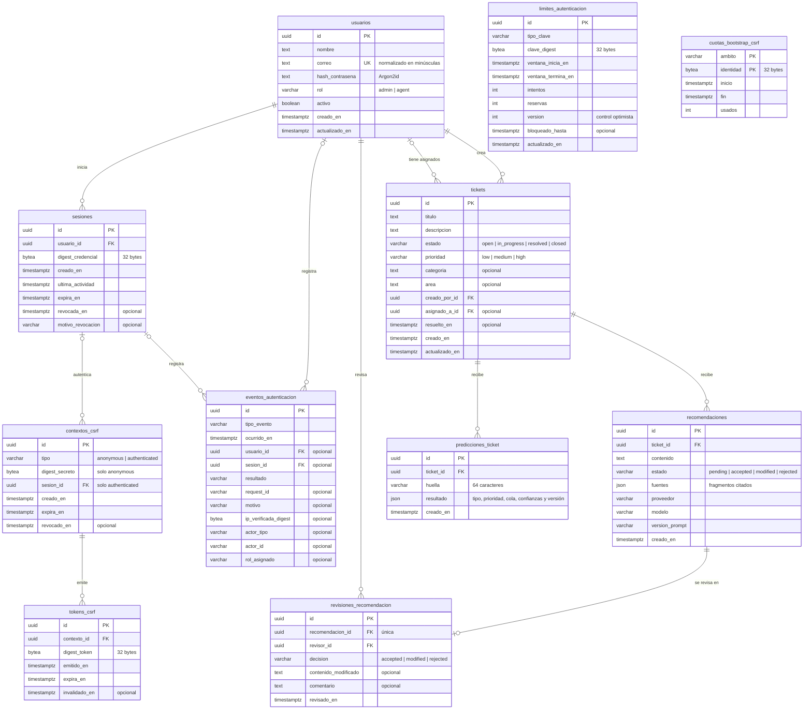

# Evidencias de sistema: Base de datos

Base de datos de SynapDesk: **PostgreSQL 17.11 con la extensión pgvector 0.8.6**, en Docker Compose
(imagen `pgvector/pgvector:0.8.6-pg17-bookworm`). El esquema se crea solo con migraciones Alembic
([`backend/migraciones/versiones/`](https://github.com/Krotzup/SynapDesk/tree/main/backend/migraciones/versiones)) y coincide con los
modelos SQLAlchemy de [`backend/app/persistencia/modelos/`](https://github.com/Krotzup/SynapDesk/tree/main/backend/app/persistencia/modelos).
Estado al 20-11-2026: rama `main` con el PR [#60](https://github.com/Krotzup/SynapDesk/pull/60) (commit `49e88f1`).

## Migraciones

| Migración | Cambios |
|---|---|
| `0001_usuarios_tickets` | Tablas `usuarios` y `tickets` |
| `0002_autenticacion_persistencia` | Tablas `sesiones`, `contextos_csrf`, `tokens_csrf`, `limites_autenticacion` y `eventos_autenticacion` |
| `0003_retirar_prioridad_critical` | Retira la prioridad `critical`: los tickets existentes pasan a `high` y la restricción admite solo `low`, `medium` y `high` |
| `0004_bootstrap_csrf` | Tabla `cuotas_bootstrap_csrf`: contadores de arranque CSRF separados del login |
| `0005_actor_bootstrap` | Columnas `actor_tipo` y `actor_id` en `eventos_autenticacion` para el alta del administrador inicial |
| `0006_user_created` | Columna `rol_asignado` en `eventos_autenticacion` para registrar altas de usuarios |
| `0007_recomendaciones_rag` | Tablas `recomendaciones` y `revisiones_recomendacion` (RAG con revisión humana) |
| `0008_predicciones_ticket` | Tabla `predicciones_ticket` (clasificación sugerida por ML) |

## Diagrama entidad-relación

## Reglas principales

- **Identificadores UUID** y fechas con zona horaria (`timestamptz`) en todas las tablas.
- **`usuarios`:** `rol` solo `admin` o `agent`; `correo` único, sin espacios y en minúsculas; nombre, correo y
  hash no vacíos. Un usuario con tickets no se puede eliminar físicamente (`RESTRICT`): se desactiva.
- **`tickets`:** `estado` en `open`, `in_progress`, `resolved` o `closed` (por defecto `open`); `prioridad` en
  `low`, `medium` o `high` (por defecto `medium`); título y descripción no vacíos; índice por estado y fecha de creación.
- **Autenticación:** credenciales, secretos y tokens se guardan solo como digest de 32 bytes, nunca en claro;
  las fechas de vigencia, revocación e invalidación se validan con restricciones `CHECK`. Un contexto CSRF es
  anónimo (con secreto y sin sesión) o autenticado (con sesión y sin secreto). Los eventos de auditoría
  conservan el registro aunque se elimine el usuario o la sesión (`SET NULL`).
- **Recomendaciones:** cada recomendación conserva su contenido original, las fuentes citadas, el proveedor, el
  modelo y la versión del prompt; tiene como máximo una revisión humana, con decisión, revisor y fecha. Las
  referencias usan `RESTRICT`, por lo que no se pierden al borrar tickets o usuarios.
- **Predicciones:** se guardan aparte de los valores confirmados del ticket, identificadas por una huella del
  texto, del artefacto y de los mapeos usados.
- **Base semántica separada:** los fragmentos con vectores de 384 dimensiones y los documentos cargados desde la
  aplicación viven en otra base con pgvector
  ([`ml/semantic_retrieval/schema.sql`](https://github.com/Krotzup/SynapDesk/blob/main/ml/semantic_retrieval/schema.sql)).

## Verificación del 20-11-2026

Ejecutada sobre el commit `49e88f1` con PostgreSQL 17.11 y pgvector 0.8.6 en bases temporales del servicio de
pruebas `db_test` (nunca en la base de desarrollo), borradas al terminar. Las salidas están en
[`Pruebas/`](Pruebas/) y no contienen credenciales.

| Archivo | Resultado |
|---|---|
| [`alembic.txt`](Pruebas/alembic.txt) | Migraciones 0001 → 0008 aplicadas; `alembic upgrade`, `current`, `heads` y `check` sin errores ni diferencias |
| [`backend-postgresql.txt`](Pruebas/backend-postgresql.txt) | **489 pruebas de integración aprobadas** con PostgreSQL real |
| [`backend-unitarias.txt`](Pruebas/backend-unitarias.txt) | 1.086 pruebas unitarias del backend aprobadas |
| [`backend-tls.txt`](Pruebas/backend-tls.txt) | 4 pruebas del canal TLS entre Next.js y FastAPI aprobadas |
| [`pt01-pt05.txt`](Pruebas/pt01-pt05.txt) | PT01–PT05: salud, disponibilidad, PostgreSQL y pgvector, migración y persistencia (20/20) |
| [`pt01-pt02-humo.txt`](Pruebas/pt01-pt02-humo.txt) | Prueba de humo: `/health` y `/ready` responden 200; al detener la base, `/ready` responde 503 sin datos internos, y vuelve a 200 al recuperarla |
| [`fecha.txt`](Pruebas/fecha.txt) | Fecha, hora y commit de la ejecución |

Para repetirla, seguir [`backend/README.md`](https://github.com/Krotzup/SynapDesk/blob/main/backend/README.md) e
[`infra/README.md`](https://github.com/Krotzup/SynapDesk/blob/main/infra/README.md).
