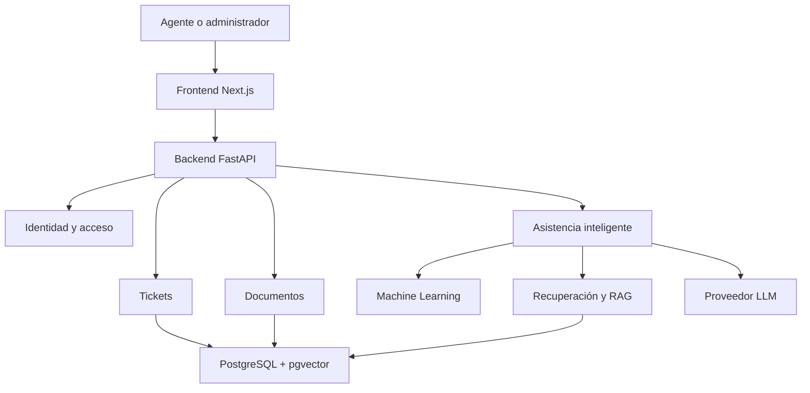

# SynapDesk

## Estado de RAG + LLM

El backend incorpora rutas optativas para recuperar evidencia, generar borradores con **Gemini 3.5 Flash-Lite**, conservar fuentes y registrar una revisión humana. El frontend ya consume las rutas de recomendaciones cuando `NEXT_PUBLIC_USE_MOCKS=false`. La generación y la búsqueda están apagadas por defecto. El piloto sintético está cerrado; sus resultados no son una medición del sistema con tickets reales.

Para preparar un entorno de evaluación:

1. Preparar el corpus oficial de Windows y Docker con las instrucciones de [ml/README.md](ml/README.md), en una base semántica distinta de la base de tickets. Revisar la procedencia y los derechos de cada fuente antes de incorporar otras. No indexar documentos con secretos ni datos de usuarios sin autorización.
2. Separar las consultas sintéticas de calibración y evaluación con `python -m ml.tools.split_procedure_cases --cases RUTA_CORPUS/cases.json --output-dir RUTA_SALIDA_NUEVA`. Indexar, calibrar y evaluar con las instrucciones de [ml/README.md](ml/README.md). El perfil V2 debe corresponder exactamente a la revisión del corpus. Configurar `SYNAPDESK_SEMANTIC_DATABASE_URL`, `SEARCH_RELEVANCE_PROFILE` y `SEARCH_ENABLED=true` según [backend/README.md](backend/README.md).
3. Aplicar la revisión Alembic `0007_recomendaciones_rag` a una base del backend preparada y respaldada. Configurar el canal TLS directo, la credencial del servicio, las cookies, sesiones, Origin y CSRF de los contratos de autenticación. El ensayo local aislado de MVP12 ya registra login y tickets; la aplicación FastAPI habitual todavía no los registra.
4. Configurar de forma privada `GEMINI_API_KEY`, `RAG_PUBLIC_ORIGIN` (origen público de Next.js autorizado), `RAG_ENABLED=true`, `RAG_TIMEOUT_SECONDS=15` y `RAG_MAX_CONTEXT_CHUNKS=5`. Activar `RAG_EXTERNAL_DATA_APPROVED=true` solo después de aprobar el tratamiento de los tickets por el proyecto Google utilizado. La modalidad gratuita de Gemini puede emplear los datos enviados para mejorar productos; para datos reales se requiere un tratamiento aprobado. El filtrado de credenciales evidentes no sustituye la revisión de privacidad.
5. En `frontend/.env.local`, configurar el canal de servidor y `NEXT_PUBLIC_USE_MOCKS=false` conforme a [frontend/.env.example](frontend/.env.example). Para el recorrido local integrado, usar el [ensayo aislado](backend/herramientas/ingreso_local/README.md#ensayo-rag-del-mvp) con `--rag`: crea una base temporal, inicia FastAPI con TLS directo y Next.js, y conecta el Asistente IA a las rutas reales. Crear un ticket pertinente al corpus, generar una recomendación con sesión real, revisar sus citas y registrar una decisión humana. Una abstención devuelve `INSUFFICIENT_INFORMATION` y no crea un borrador. Aceptar la recomendación no resuelve el ticket.

El [contrato de recomendaciones](docs/contratos/recomendaciones-rag-v1.md) fija las rutas, estados, errores y responsabilidades. Para validar el módulo sin Gemini ni base de datos: `python -m unittest discover -s backend/pruebas -p 'test_generacion_rag.py'`. La validación completa requiere base de datos migrada, perfil V2 vigente, sesión/CSRF operativos y credenciales aprobadas.

Para revisar manualmente un caso sintético del pipeline real, ejecuta desde la raíz del repositorio en PowerShell:

```powershell
$env:PYTHONPATH='backend;.'
$env:HF_HUB_OFFLINE='1'
$env:TRANSFORMERS_OFFLINE='1'
python -m herramientas.evaluar_rag_sintetico --cases ml/artifacts/procedimientos_v1_cases/evaluacion.json --case-id P01-2 --output ml/artifacts/rag_evaluacion_local/P01-2.json
```

Cada ejecución procesa **un caso** y crea un informe nuevo bajo `ml/artifacts/`, excluido de Git. Antes de ejecutarlo, crea el directorio de salida, prepara la base semántica y configura `GEMINI_API_KEY` solo en el `.env` local. El informe incluye el borrador, los fragmentos citados, latencia y una sección `humanReview` sin rellenar. Un especialista debe valorar el sustento de cada paso, utilidad y seguridad; coincidencia de identificadores y consulta sintética no equivalen a aprobación humana. La aplicación registra por separado duración, estado y contadores de tokens que devuelva Gemini, sin registrar el ticket ni las respuestas.

Una vez generados los informes individuales, crea un resumen nuevo con `python -m herramientas.resumir_evaluacion_rag --reports-dir ml/artifacts/rag_evaluacion_local --output ml/artifacts/rag_evaluacion_local/summary.json`. El resumen registra aciertos automáticos, casos pendientes de revisión, duración observada y los identificadores de fallos; no copia consultas, fuentes ni borradores. La herramienta no sobrescribe informes previos.

En una verificación local del 19 de noviembre de 2026, el corpus oficial de Windows y Docker produjo 15 documentos y 340 fragmentos. Se calibró con 17 consultas sintéticas y se evaluó con otras 16: 14 de 15 consultas con cobertura fueron aceptadas, la consulta sin cobertura fue rechazada y el documento esperado ocupó el primer lugar en 13 de 15. Al ejecutar recuperación y Gemini sobre los 16 casos reservados, se obtuvieron 13 borradores con el documento esperado citado entre los 15 casos con cobertura y la abstención prevista para el caso sin cobertura. Los casos `P14-2` y `P15-2` terminaron en abstención pese a esperar un borrador; requieren revisión de evidencia y de la recuperación. Ningún borrador ha recibido aún aprobación humana. La mediana observada fue de 2,0 s y el p95 de 14,6 s para estas 16 ejecuciones locales; no representan un benchmark de capacidad. La base principal llegó a la revisión `0007_recomendaciones_rag`; la búsqueda del backend y el orquestador con proveedor simulado se comprobaron contra PostgreSQL real. En una base PostgreSQL desechable, con identidad y generador simulados, se comprobó por HTTP crear, listar, revisar, consultar y volver a generar un borrador después de la revisión. En otra base desechable, un ticket sintético recorrió la ruta HTTP con recuperación y Gemini reales, creó un borrador con dos fuentes y aceptó la revisión. Ambas bases de ensayo se eliminaron. Estos datos **no** acreditan calidad con tickets reales ni validación integral desde la interfaz: las pruebas HTTP sustituyeron la autenticación. Las etiquetas sintéticas están pendientes de revisión humana y el umbral no se ajustó usando la evaluación reservada.

En un ensayo adicional del mismo día, la composición local de testing integró login HTTP, CRUD de tickets, recuperación V2, Gemini y revisión RAG con Next.js y Edge reales. Un agente creó un ticket sintético de DNS, obtuvo un borrador con fuentes, lo aceptó y comprobó la revisión tras recargar. PostgreSQL confirmó que el borrador y la revisión persistieron y que aceptar no cambió el estado del ticket. El navegador superó 99 comprobaciones; la base temporal del notebook se eliminó y se cerraron Next.js y FastAPI. El [procedimiento reproducible](backend/herramientas/ingreso_local/README.md#ensayo-rag-del-mvp) limita esta acreditación al entorno local de testing: no demuestra despliegue Render, capacidad productiva ni calidad aprobada por especialistas.

Para evaluar un registro del dataset traducido V2, usa `python -m herramientas.evaluar_rag_tickets_v2 --row-number 835 --output ml/artifacts/rag_tickets_v2_local/row-835-nuevo.json` desde la raíz, con `PYTHONPATH=backend;.` y la configuración semántica y de Gemini preparadas. Activa `RAG_EXTERNAL_DATA_APPROVED=true` en el entorno del proceso solo cuando el proyecto Google tenga aprobado el tratamiento de estos tickets. La herramienta comprueba la huella SHA-256 documentada, las 2.239 filas y las 13 columnas; rechaza patrones evidentes de contacto o credenciales, no envía la respuesta histórica y guarda el informe solo bajo `ml/artifacts/`, excluido de Git. El informe remite al número de registro del CSV privado y deja vacía la revisión humana. El filtro automático no garantiza anonimización completa.

En una muestra inicial de cuatro tickets V2 relacionados por palabras clave con el corpus, Gemini produjo un borrador de dos fuentes para un caso DNS y se abstuvo en los otros tres. El caso DNS describe un problema general; sus pasos citan documentación pertinente, pero un especialista debe decidir si son útiles y seguros para ese incidente. Esta muestra no mide calidad representativa. La selección local encontró casos de Windows, red e impresoras, pero no casos de Docker para evaluar esa parte del corpus con este dataset.

Para ejecutar PostgreSQL en otro equipo de la misma red durante desarrollo, inicia allí `docker compose up -d db` y crea una sola vez `synapdesk_semantic` como base distinta de `synapdesk`. En el PC del backend, configura en `.env` privado `POSTGRES_HOST` con la IPv4 de ese equipo y `SYNAPDESK_SEMANTIC_DATABASE_URL` con la conexión a la base semántica; codifica la contraseña para URL si contiene caracteres especiales. Comprueba la conexión antes de aplicar Alembic o indexar. Restringe el acceso al puerto `5432` a la red y los equipos autorizados; no publiques el puerto en el router. El `.env`, los corpus descargados y los perfiles generados son locales y no se incluyen en Git.

### Operación de RAG

- La activación de generación exige `RAG_ENABLED=true` y `RAG_EXTERNAL_DATA_APPROVED=true` además de clave, búsqueda, base y sesión operativas. No activar el segundo indicador para tickets reales sin aprobación del tratamiento de datos. Para suspender la generación, establecer `RAG_ENABLED=false`; esto cierra también la lectura de recomendaciones por estas rutas.
- Vigilar los registros `rag outcome` y `rag provider`: resultado, etapa, duración, estado HTTP de fallos y contadores de tokens disponibles. Agregar métricas por ventana sin incluir tickets, fragmentos, respuestas, cookies ni claves. La prueba local de dos consultas no establece cuotas, capacidad ni objetivo de latencia.
- Ante `SEARCH_PROFILE_STALE`, verificar versión del corpus y recalibrar con el conjunto de calibración; conservar separado el conjunto de evaluación. Ante `GENERATION_UNAVAILABLE`, comprobar servicio, cuota y clave de Gemini sin registrar la respuesta privada. Una generación fallida o sin evidencia no crea borrador; no reenviar automáticamente escrituras con resultado incierto.
- Antes de desplegar, medir cobertura, proporción de abstenciones, fallos, latencia p50/p95, tokens y calidad humana de citas con casos representativos. Definir entonces límites de uso, alertas, capacidad y procedimiento de rotación de la clave. Ninguno de esos valores productivos queda certificado por el piloto sintético.

**SynapDesk** es un proyecto de plataforma web inteligente de soporte TI orientado a asistir a agentes y administradores de mesas de ayuda en la clasificación, priorización y resolución de tickets.

El sistema combinará **Machine Learning**, recuperación semántica, **Retrieval-Augmented Generation (RAG)** y **Large Language Models (LLM)** para transformar documentación técnica y tickets históricos en recomendaciones contextualizadas y respaldadas por fuentes.

La inteligencia artificial no reemplazará al especialista. Las recomendaciones estarán sujetas a validación humana.

## Objetivo

Diseñar, desarrollar y evaluar una plataforma que asista a equipos de soporte TI mediante un flujo inteligente de clasificación automática, recuperación de información y generación contextualizada de recomendaciones.

El flujo general previsto es:

```text
Ticket → clasificación y priorización ML → recuperación semántica → RAG → LLM → recomendación con fuentes → validación humana
```

## Alcance funcional

SynapDesk contempla:

* gestión de usuarios y roles;
* creación y administración de tickets;
* clasificación automática de incidencias mediante Machine Learning;
* estimación de categoría, prioridad y nivel de confianza;
* gestión de documentación técnica;
* generación y almacenamiento de embeddings;
* búsqueda semántica mediante PostgreSQL y pgvector;
* recuperación de documentación y tickets históricos similares;
* generación contextualizada de recomendaciones mediante RAG y LLM;
* visualización de las fuentes utilizadas;
* aceptación, modificación o rechazo de recomendaciones;
* registro de predicciones, revisiones humanas y métricas de evaluación.

Las funcionalidades se desarrollarán incrementalmente. Su presencia en esta sección representa el alcance previsto del producto, no necesariamente su estado actual de implementación.

## Tecnologías adoptadas

Las siguientes tecnologías conforman la base técnica adoptada para la construcción inicial del MVP. Su incorporación efectiva se realizará progresivamente durante el desarrollo.

### Frontend

* Next.js
* React
* Tailwind CSS

### Backend

* Python
* FastAPI
* Pydantic

### Persistencia

* PostgreSQL
* pgvector

### Infraestructura y desarrollo

* Docker y Docker Compose
* Git y GitHub
* GitHub Projects para la gestión del trabajo
* Jupyter Notebook o Google Colab para la experimentación de Machine Learning

## Tecnologías de inteligencia artificial en evaluación

* Scikit-learn para los modelos base de clasificación;
* PyTorch, TensorFlow o Hugging Face únicamente si el modelo seleccionado los requiere;
* modelo de embeddings pendiente de evaluación;
* Gemini 3.5 Flash-Lite seleccionado para borradores RAG, con activación operativa pendiente;
* LangChain o LlamaIndex únicamente si aportan un valor demostrado al pipeline RAG.

La selección definitiva dependerá de los resultados obtenidos sobre los datos del proyecto. No se asume que todas estas tecnologías serán utilizadas simultáneamente.

## Arquitectura conceptual

SynapDesk comenzará como un **monolito modular**. Los módulos estarán separados internamente, pero el backend se desplegará inicialmente como una sola aplicación FastAPI.



Esta arquitectura busca favorecer la modularidad, el bajo acoplamiento, la mantenibilidad, las pruebas y la integración progresiva, sin introducir inicialmente la complejidad operacional de una arquitectura de microservicios.

## Machine Learning

El componente de Machine Learning analizará el asunto y la descripción de los tickets para estimar atributos como:

* categoría;
* prioridad;
* área responsable, si el conjunto de datos permite evaluarla adecuadamente.

Los modelos candidatos se evaluarán con métricas apropiadas para clasificación, entre ellas:

* precisión;
* exhaustividad (*recall*);
* macro F1-score;
* weighted F1-score;
* matriz de confusión.

Los valores objetivo y los criterios mínimos de aceptación se establecerán después de obtener un modelo base sobre el conjunto de datos seleccionado.

El modelo seleccionado deberá convertirse en un artefacto versionado e integrable. Un notebook por sí solo no se considerará un entregable ejecutable del producto.

## RAG y recuperación semántica

El pipeline RAG recupera actualmente fragmentos de una base semántica separada. El corpus de evaluación disponible contiene procedimientos oficiales de Windows y Docker. La visión incluye también:

* documentación técnica;
* manuales y procedimientos;
* tickets históricos;
* soluciones anteriores.

La información recuperada se utilizará como contexto controlado para generar recomendaciones. El sistema deberá conservar trazabilidad sobre las fuentes y comunicar cuando no exista información suficiente.

La recuperación y la generación permanecerán separadas para poder evaluarlas y probarlas independientemente.

## Validación humana

Las recomendaciones generadas por inteligencia artificial no reemplazarán la decisión del agente.

El usuario podrá:

* aceptar una recomendación;
* modificarla;
* rechazarla;
* consultar las fuentes utilizadas;
* entregar retroalimentación opcional.

El sistema registrará la recomendación original, la decisión humana, el usuario revisor y la fecha correspondiente.

## Equipo y responsabilidades

El proyecto es desarrollado por tres integrantes con las siguientes responsabilidades principales:

* arquitectura, backend, integración técnica y coordinación funcional del backlog;
* Machine Learning, datos, entrenamiento y evaluación de modelos;
* frontend, experiencia de usuario y facilitación del proceso Scrum.

Las decisiones técnicas y funcionales relevantes se revisan de manera colaborativa.

## Metodología

El desarrollo se organiza mediante **Scrum**, complementado con prácticas ligeras de MLOps para mantener trazabilidad sobre datasets, experimentos, modelos, versiones y métricas.

El equipo trabaja mediante ramas de corta duración, pull requests, revisión entre integrantes e integración progresiva en `main`.

## Estado del proyecto

SynapDesk se encuentra en desarrollo como parte de un **Proyecto APT de Ingeniería Informática**.

El proyecto se encuentra actualmente en su etapa de preparación técnica y construcción inicial del MVP.

### Avances completados

* definición inicial del alcance;
* arquitectura inicial basada en un monolito modular;
* estructura del monorepositorio;
* convenciones para ramas, commits y pull requests;
* proceso de revisión e integración de cambios;
* entorno local reproducible mediante Docker Compose;
* PostgreSQL 17 con pgvector 0.8.6;
* recuperación semántica optativa expuesta por HTTP, con perfil de relevancia V2;
* orquestador RAG optativo con Gemini, citas comprobadas y revisiones persistentes; flujo integral verificado en el ensayo local de testing;
* separación inicial entre los entornos de desarrollo y pruebas;
* documentación de la estrategia futura de staging.

### Trabajo pendiente

Las rutas HTTP de autenticación y tickets funcionan en una composición local de testing, pero siguen cerradas en la aplicación habitual. Quedan pendientes su activación operativa segura, la ingestión de documentación desde la interfaz y la integración ML con tickets. La calidad de las recomendaciones y la ampliación del corpus requieren evaluación humana; el ensayo local integral no acredita producción.

La estrategia de staging ha sido definida y aceptada por el equipo, pero el entorno todavía no se encuentra desplegado.

El objetivo semestral es obtener una versión:

* funcional;
* integrada;
* evaluada;
* documentada;
* contenerizada;
* desplegada en un entorno demostrativo.

## Documentación del proyecto

La documentación técnica se mantiene versionada junto al código:

* [Organización de la documentación](docs/README.md)
* [Estructura inicial del repositorio](docs/arquitectura/estructura-repositorio.md)
* [Estrategia de entornos](docs/arquitectura/entornos.md)
* [Estrategia Git](docs/gestion/estrategia-git.md)
* [Definición de Terminado](docs/gestion/definicion-terminado.md)
* [Registros de decisiones arquitectónicas](docs/adr/)
* [Contratos de integración](docs/contratos/)

Las reglas para ramas, commits y pull requests se encuentran en [CONTRIBUTING.md](CONTRIBUTING.md).

## Inicio rápido del entorno local

Crear la configuración local a partir de la plantilla.

En Git Bash:

```bash
cp .env.example .env
```

En Símbolo del sistema de Windows:

```cmd
copy .env.example .env
```

Modificar las contraseñas locales en `.env` y levantar PostgreSQL:

```bash
docker compose up -d db
docker compose ps
```

Las instrucciones completas de configuración, ejecución y diagnóstico se encuentran en [infra/README.md](infra/README.md).

## Fuera del alcance actual

Durante el semestre no se contempla desarrollar:

* una API empresarial pública para terceros;
* integraciones con Zendesk, Jira Service Management o Freshdesk;
* multi-tenancy empresarial;
* facturación o planes comerciales;
* una arquitectura de microservicios;
* un portal para desarrolladores;
* acuerdos de nivel de servicio empresariales.

El backend sí contará con endpoints internos para la comunicación entre el frontend y los componentes de SynapDesk. Estos endpoints no corresponden a una API empresarial pública.

## Evolución futura

Después de validar y desplegar la plataforma web, podrá evaluarse una API empresarial para integrar las capacidades de SynapDesk con sistemas externos de mesa de ayuda.

Esta posibilidad se considera trabajo futuro y no forma parte del alcance principal del Proyecto APT.

## Licencia

La licencia será definida según los criterios académicos, institucionales y de propiedad intelectual acordados por el equipo.

Esta definición pendiente corresponde al código y documentación propios de
SynapDesk. El dataset externo usado por el componente ML tiene una licencia
independiente CC BY-NC 4.0 y requisitos de atribución, indicación de cambios y
uso no comercial; consultar su [procedencia y condiciones](ml/DATASET_PROVENANCE.md).
